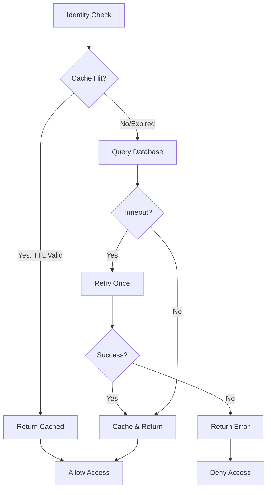
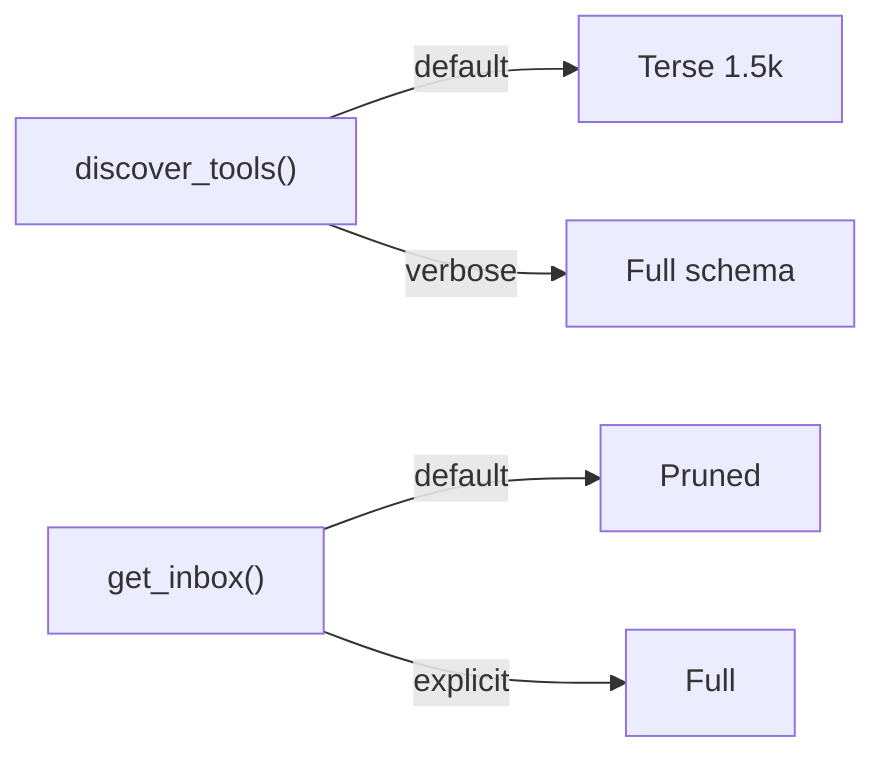

# Changelog — auto-assembled by the niwa scribe at merge

## [relay/identity] a host stall of a few seconds never fails an authed call, and the relay stops adding its own multi-second integrity scans to the load

Identity verification now retries once on timeout and caches results for 3 seconds, preventing authentication failures during host stalls.

## [audit T5] compact boot payloads: discover_tools terse by default, re-register minimal, inbox budgeted

discover_tools returns compact signatures by default (name, description, required params) instead of full schemas to reduce boot payloads; get_inbox applies context budget constraints by default to prevent inbox overflow.

